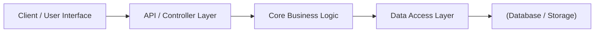

# System Architecture

## 1. Architectural Style
- Pattern: xxx
- Rationale: xxx

## 2. Component Interaction Diagram (Mermaid)

## 3. Data Flow & Execution Lifecycle
1. Ingestion: xxx
2. Processing: xxx
3. Persistence & Response: xxx

## 4. Architecture Design Records (ADRs)
- ADR-01: xxx
